## Introducción
[Manual Monitor8](Manual+Monitor8.md)

[Planta de Hidroalquilacion de Tolueno/Gemelos Digitales Monitor8_V0.pptx](planta-de-hidroalquilacion-de-tolueno-gemelos-digitales-monitor8_v0pptx.md)

## Plantas desarrolladas
||Planta||Nombre||Estado Actual||Mejoras previstas |
| [Planta de Hidroalquilacion de Tolueno](Planta+de+Hidroalquilacion+de+Tolueno.md) | hda_1 | Operativa |

## Plantas en desarrollo
||Planta||Nombre||Estado Actual||Fecha estimada |
|[Planta de Tratamiento AARR](Planta+de+Tratamiento+AARR.md)|ptar_1|En desarrollo|Julio 2023 |
|[Planta de Fabricación de Cerveza](Planta+de+Fabricaci%C3%B3n+de+Cerveza.md)|ptar_1|En desarrollo|Julio 2023 |
|[Planta de Fabricación de Biodiésel](Planta+de+Fabricaci%C3%B3n+de+Biodi%C3%A9sel.md)|ptar_1|En desarrollo|Julio 2023 |

## Organización de las prácticas
[ManualTrainer](ManualTrainer/)

## Acceso a Monitor8

Cada grupo tiene acceso a una planta de manera exclusiva, el nombre de la página web de acceso se construye de la siguiente manera:

**xxxx.servehttp.com:8080/yyyy**

donde **xxxx** es el nombre del servidor e **yyyy** es el nombre de la Planta

por ejemplo:

http://hda.servehttp.com:8080/hda_1

# Navegación y Roles
Existen, entre otros, los nombres de usuario y Rol siguientes:
||Nombre||Rol||Información a la que accede |
|CAMPO|Operador de Campo|Instrumentación remota |
|PANEL|Operador de DCS o Panel|Instrumentos y actuadores locales |
|PLANIFICADOR|Jefe de Planificación y Logística|gestión administrativa de Terminales |
|DIRECCION|Director|A toda la información excepto la exclusiva del TRAINER |
|INGENIERIA|Ingeniería|A toda la información excepto la exclusiva del TRAINER |
|TRAINER|Profesor|A toda la información de la planta |

A cada usuario se le asigna una contraseña de acuerdo a su Rol

Accedemos a cada perfil y observamos la información que hay disponible

Por ejemplo, en el perfil de **operador de panel** tenemos:

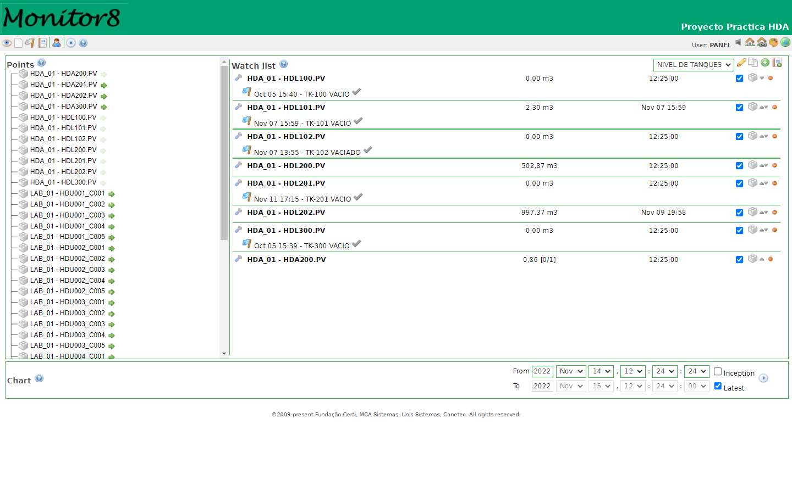
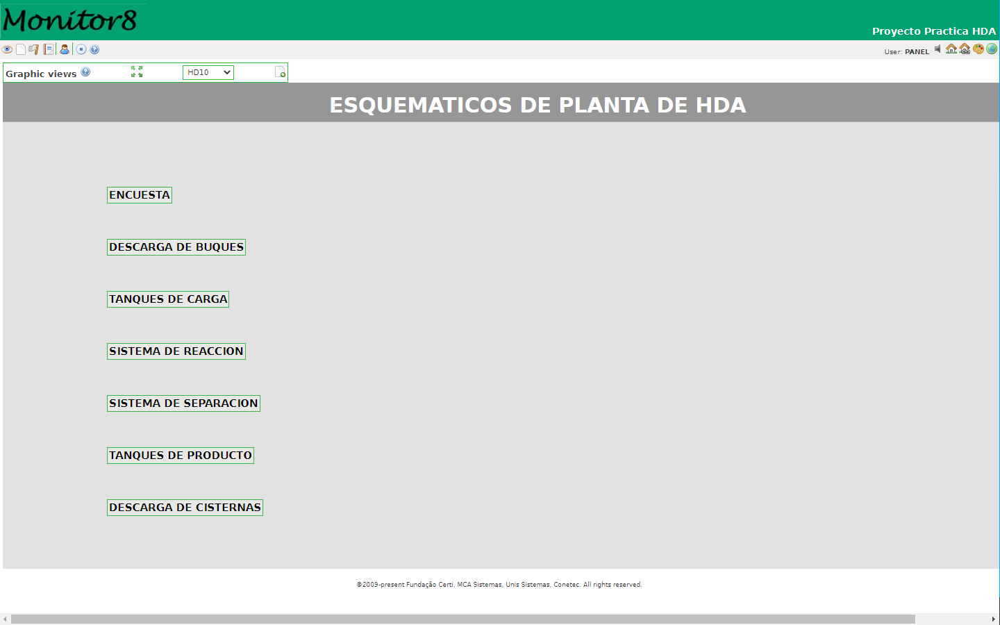
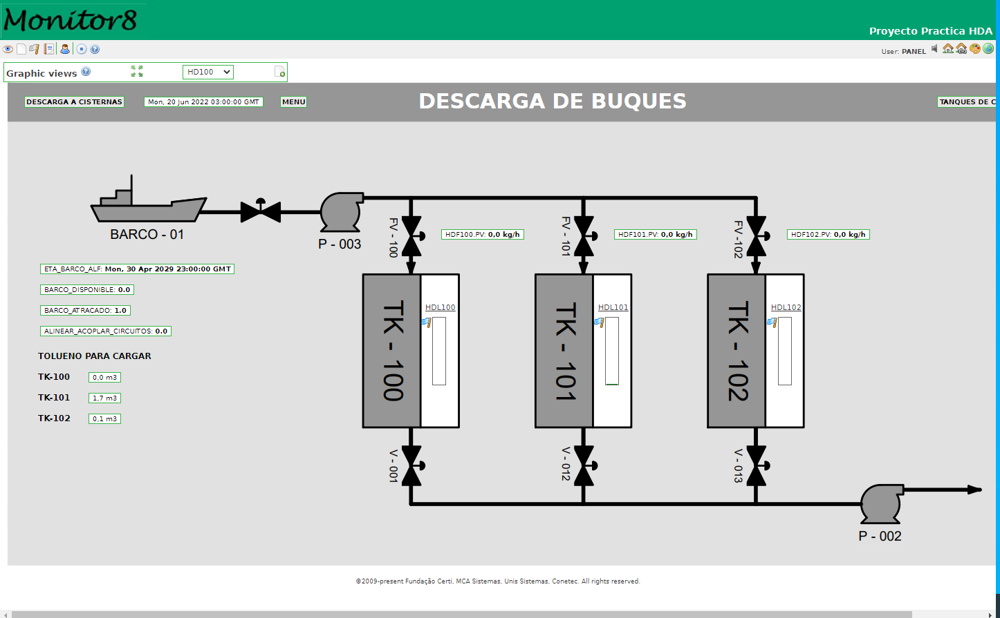
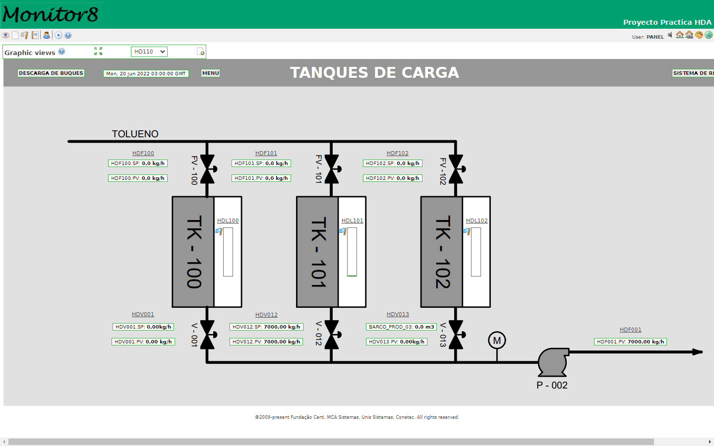
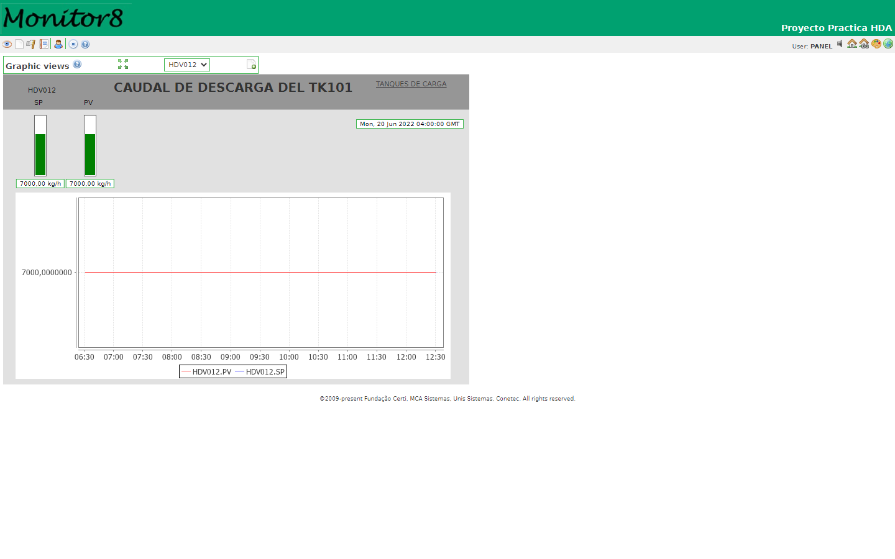
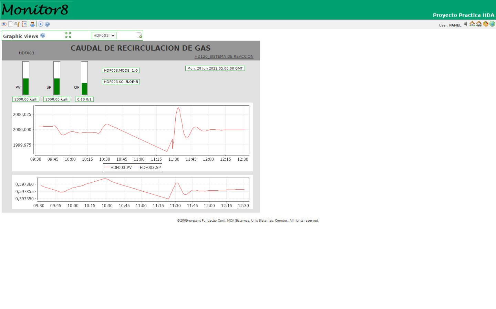
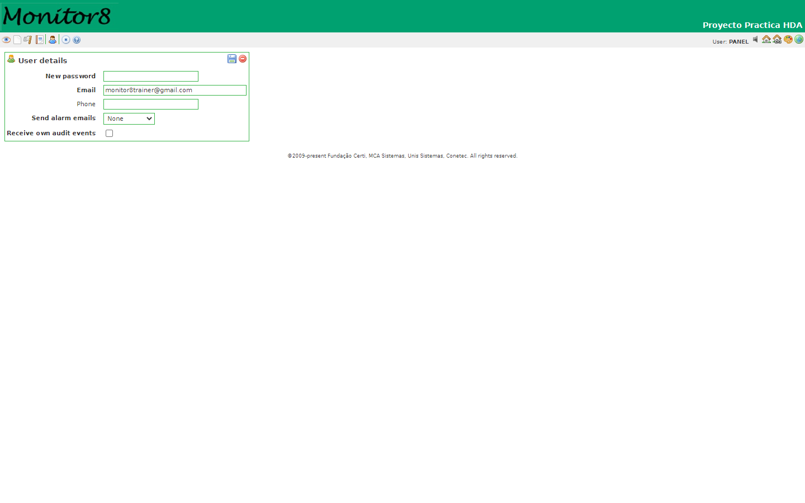
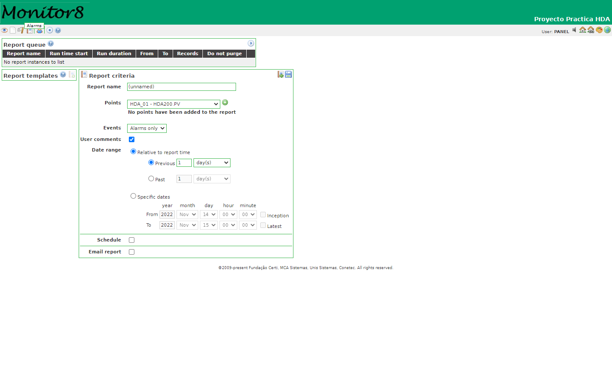
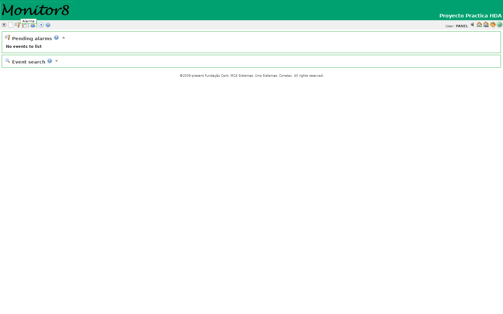
## Acceso a informacion de Monitor8 por medio de Telegram

Es necesario tener una cuenta de usuario de Telegram e iniciar un chat con Monitor8Trainer por lo que buscamos ese usuario en Telegram con **@Monitor8Trainer**.

Este es un Bot que nos permite acceder a la información de la planta y los tags que se especifiquen. Lo primero que hay que hacer es arrancar el chat con Telegram para que nos tenga identificados escribiendo **/start** a lo que nos contestará con el siguiente mensaje:

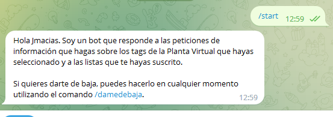
Tambien podemos preguntar por **/quieneres** a lo que nos contestará con:

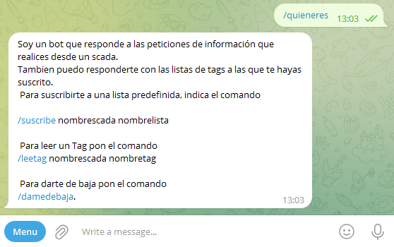
Por último, se puede preguntar por la información deseada, como por ejemplo **/leetag hda_1 HDF003.PV HDA001** que indica que necesitamos información de la Planta **hda_1** y queremos el item de instrumentacion **PV** correspondiendo al Tag **HDF003** y todos los items disponibles para el tag **HDA001**

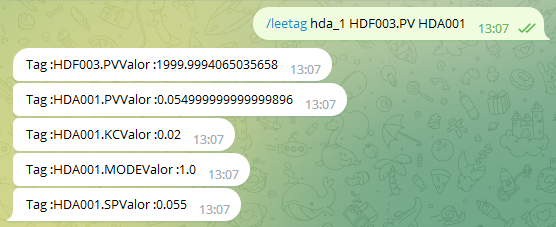
## Gestión con el correo electronico

http://hda.servehttp.com:8080/M8TWiki/Wiki.jsp?page=Manual%20Monitor8#section-Manual+Monitor8-RobotDeRespuestaAutom_C3_A1ticasDeCorreoElectr_C3_B3nico
## Uso de Meet

http://hda.servehttp.com:8080/M8TWiki/Wiki.jsp?page=Manual%20Monitor8#section-Manual+Monitor8-Videoconferencia
